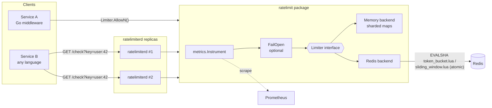
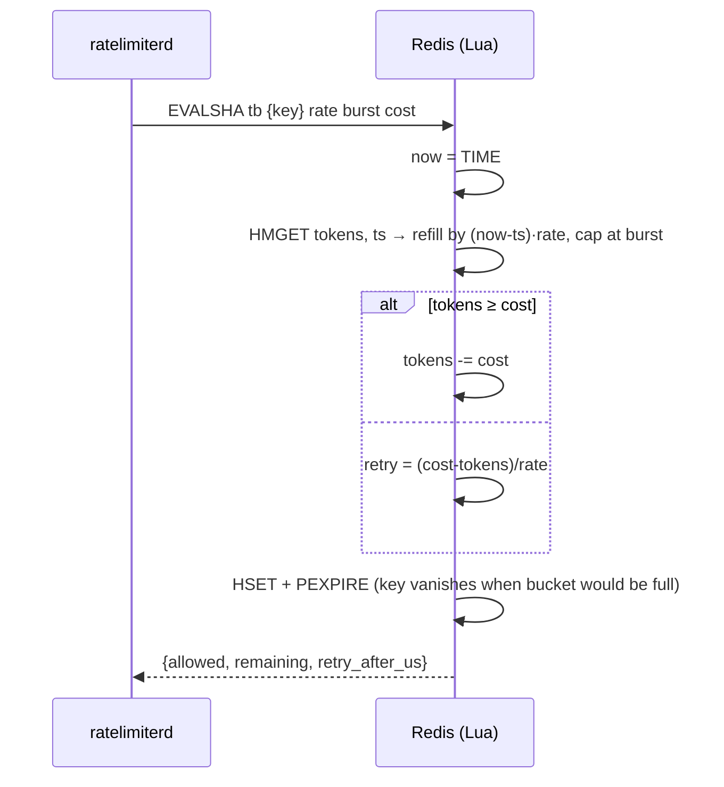

# distributed-rate-limiter

[](https://github.com/HOFFMAN-ALTERNATIVE/distributed-rate-limiter/actions/workflows/ci.yml)


[](LICENSE)

A production-style **distributed rate limiter** in Go: a library *and* a standalone
HTTP service. Token bucket and sliding-window-log algorithms, an in-memory backend
for single instances and a **Redis backend where every decision is one atomic Lua
script**, `net/http` middleware, Prometheus metrics, env-based config, a distroless
image and a two-instance docker-compose demo.

## Why

Rate limiting looks trivial until you run more than one replica. Per-process
counters multiply the real limit by the replica count, and naive
`GET` → compute → `SET` against Redis races under load and lets bursts through.
This project shows how to do it correctly:

- **One round-trip, zero races.** Read-refill-consume-write happens inside Redis
  in a single `EVALSHA`; there is no window between check and update.
- **One clock.** Scripts use Redis `TIME`, so replicas with skewed clocks still
  agree on a single timeline.
- **Exactness is tested**, not assumed: the integration suite runs four
  independent clients against one Redis and asserts the global limit is hit
  *exactly* — never one request more.

## Features

| | |
|---|---|
| Algorithms | Token bucket (rate + burst), sliding window log (exact N per window) |
| Backends | In-memory (64-way lock striping, zero allocations) · Redis / Redis Cluster (hash-tagged keys) |
| Weighted requests | `AllowN(ctx, key, cost)` — e.g. charge expensive endpoints more |
| Integration | `net/http` middleware with `RateLimit-Limit`, `RateLimit-Remaining`, `Retry-After` headers; pluggable key funcs |
| Service | `ratelimiterd`: `/check`, `/demo`, `/healthz`, `/readyz`, `/metrics` |
| Failure policy | Fail-closed by default (503); opt-in fail-open wrapper |
| Observability | `ratelimit_decisions_total`, `ratelimit_errors_total`, `ratelimit_decision_duration_seconds` |
| Ops | Distroless non-root image, graceful shutdown, server timeouts, bounded memory via periodic sweep |
| Quality | `go test -race`, real-Redis integration tests in CI, benchmarks, golangci-lint (15 linters), Docker smoke test |

## Architecture



Decision flow inside Redis (token bucket):



## Quickstart

### As a service (docker compose: 2 replicas + Redis)

```bash
docker compose up --build
# Both replicas share one bucket per key (burst 10, 5 req/s):
for i in $(seq 1 12); do curl -s "localhost:808$((i%2+1))/check?key=alice"; done
```

```json
{"allowed":true,"key":"alice","limit":10,"remaining":9,"retry_after_ms":0}
...
{"allowed":false,"key":"alice","limit":10,"remaining":0,"retry_after_ms":187}
```

Allowed → `200`, limited → `429` with `Retry-After`. Weighted calls:
`/check?key=alice&cost=5`.

### As a library

```go
import (
    "github.com/HOFFMAN-ALTERNATIVE/distributed-rate-limiter/middleware"
    "github.com/HOFFMAN-ALTERNATIVE/distributed-rate-limiter/ratelimit"
    "github.com/redis/go-redis/v9"
)

rdb := redis.NewClient(&redis.Options{Addr: "localhost:6379"})
limiter, _ := ratelimit.NewRedisTokenBucket(rdb, ratelimit.TokenBucket{Rate: 10, Burst: 20})

// Key by API key header, fail open if Redis is down.
mw := middleware.RateLimit(ratelimit.FailOpen(limiter, nil), middleware.Options{
    Key: middleware.KeyByHeader("X-API-Key"),
})
http.ListenAndServe(":8080", mw(appHandler))
```

Swap `NewRedisTokenBucket` for `NewMemoryTokenBucket`, `NewRedisSlidingWindow` or
`NewMemorySlidingWindow` — they all implement `ratelimit.Limiter`.

### Configuration (environment)

| Variable | Default | Meaning |
|---|---|---|
| `RL_ADDR` | `:8080` | Listen address |
| `RL_BACKEND` | `memory` | `memory` or `redis` |
| `RL_ALGORITHM` | `token_bucket` | `token_bucket` or `sliding_window` |
| `RL_RATE` / `RL_BURST` | `10` / `20` | Token bucket refill (tokens/s) and capacity |
| `RL_LIMIT` / `RL_WINDOW` | `100` / `1m` | Sliding window: max events per window |
| `RL_REDIS_ADDR` / `RL_REDIS_DB` | `localhost:6379` / `0` | Redis connection |
| `RL_KEY_PREFIX` | `rl:` | Namespace for Redis keys |
| `RL_FAIL_OPEN` | `false` | Allow requests when the backend errors |
| `RL_BACKEND_TIMEOUT` | `50ms` | Per-decision deadline |

## Design decisions & trade-offs

- **Token bucket vs sliding log.** Token bucket is O(1) memory per key and allows
  controlled bursts — the right default for APIs. Sliding log is *exact* (no 2×
  burst at window boundaries like fixed windows), at O(limit) memory per key;
  use it for low limits where precision matters (logins, verification-code sends, payments).
  The in-memory sliding log uses a fixed ring buffer so it never allocates on the
  hot path.
- **Lua over `MULTI`/`WATCH`.** Optimistic transactions retry under contention —
  exactly when a limiter is busiest. A script runs atomically with no retries and
  a single round-trip.
- **Redis time, not client time.** Avoids clock-skew bugs across replicas at the
  cost of one extra `TIME` call inside the script (sub-microsecond).
- **Self-expiring keys.** Bucket keys expire when they would be full again, log
  keys after one window, so Redis memory tracks *active* keys only and needs no
  cleanup job. An absent key is semantically a full bucket.
- **Cluster-ready keys.** The user key is wrapped in a hash tag
  (`rl:tb:{user:42}`) so each script touches exactly one slot.
- **Fail-closed by default.** A limiter that silently disappears when Redis does
  is a security hole for login/abuse use cases. Availability-first services opt
  into `FailOpen` explicitly; swallowed errors are still counted in metrics.
- **No per-key metric labels.** Keys are unbounded (IPs, users); labelling by key
  would explode Prometheus cardinality. Metrics are per limiter and decision.
- **Middleware does not trust `X-Forwarded-For`** by default — spoofable headers
  must be an explicit choice (`KeyByHeader`) behind a trusted proxy.

## Benchmarks

`make bench` on an 8-vCPU Xeon VM (Go 1.24, `-race` off):

```
BenchmarkMemoryTokenBucket_HotKey-8       260.7 ns/op   0 B/op   0 allocs/op
BenchmarkMemoryTokenBucket_10kKeys-8       54.5 ns/op   0 B/op   0 allocs/op
BenchmarkMemorySlidingWindow_10kKeys-8     55.2 ns/op   0 B/op   0 allocs/op
```

The hot-key case is bound by a single shard mutex (worst case: every goroutine
on one key); spread keys scale across the 64 shards. The Redis backend is
dominated by network round-trip time — CI runs `BenchmarkRedisTokenBucket`
against a real Redis service container on every push.

## Development

```bash
make test         # unit tests with -race (Lua scripts run on miniredis)
make integration  # real Redis: REDIS_ADDR=localhost:6379
make bench
make lint         # golangci-lint
make docker && make up
```

CI (`.github/workflows/ci.yml`): golangci-lint · unit tests on Go 1.22 and 1.23 ·
integration tests + benchmarks against a Redis 7 service container · Docker
build and HTTP smoke test of the image.

## Project layout

```
ratelimit/          core: Limiter interface, memory + Redis backends, Lua scripts
middleware/         net/http middleware and key functions
metrics/            Prometheus instrumentation decorator
internal/config/    env configuration
internal/server/    HTTP API of ratelimiterd
cmd/ratelimiterd/   service entrypoint
```

## License

MIT © Herman Hoffman
